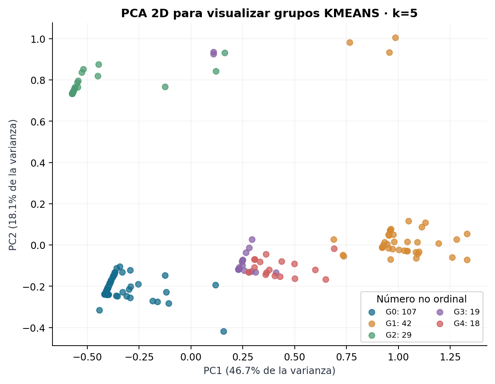

# GIRS 2024 | Machine Learning para inteligencia territorial

### De datos públicos a conocimiento estratégico para la gestión municipal

**Proyecto de Ciencia de Datos y aprendizaje automático no supervisado aplicado a la gestión de residuos sólidos en Ecuador.** Integra auditoría de datos, preparación de variables, segmentación con **K-Means y clustering jerárquico (Ward)**, análisis de componentes principales (**PCA**) y validación de estabilidad para descubrir patrones interpretables en **215 municipios**.

[](https://www.python.org/)
[](https://scikit-learn.org/)
[](https://colab.research.google.com/)


**PUCE · Ingeniería en Ciencia de Datos · Aprendizaje Automático Inicial · Reto 01**

> **Pregunta central:** ¿Qué perfiles de gestión de residuos sólidos se observan en los municipios ecuatorianos y cómo pueden contribuir a formular recomendaciones técnicas diferenciadas?

## Resultados destacados

| Indicador | Resultado |
|---|---:|
| Municipios en la base auditada | **221** |
| Escenario principal / conservador | **215 / 204** |
| Perfiles interpretables seleccionados | **5** |
| Silueta de K-Means, k = 5 | **0,5935** |
| Silueta de Ward, k = 5 | **0,5787** |
| Concordancia K-Means–Ward (ARI) | **0,8791** |
| Estabilidad media entre semillas (ARI) | **0,9950** |
| Varianza explicada por los dos primeros componentes PCA | **64,72 %** |

Se compararon ambos algoritmos para **k = 2, 3, 4, 5 y 6**. La elección de cinco grupos equilibra separación estadística, tamaños de grupo y claridad de interpretación; **no** responde simplemente al máximo valor de silueta.

### Cinco perfiles municipales

| Grupo | Perfil descriptivo | Municipios |
|---|---|---:|
| 0 | Sin diferenciación ni actividad orgánica declarada | 107 |
| 1 | Recolección diferenciada y actividad orgánica declaradas | 42 |
| 2 | Botadero como disposición principal y poca diferenciación | 29 |
| 3 | Recolección diferenciada sin actividad orgánica | 19 |
| 4 | Actividad orgánica y poca diferenciación | 18 |
| **Total** | | **215** |

Los grupos describen **similitudes en las características declaradas**. No constituyen un índice de calidad, una clasificación oficial, una inferencia causal ni una autorización automática para priorizar inversiones.

## Visualización y análisis



*Proyección de los municipios en los dos primeros componentes principales, que resumen el 64,72 % de la variabilidad de las cinco características utilizadas.*

También pueden explorarse la [comparación de siluetas](03_hito3/figuras/01_comparacion_silueta.png), los [perfiles municipales](03_hito3/figuras/06_perfiles_porcentajes.png) y el [análisis de sensibilidad](03_hito3/figuras/08_sensibilidad_204_vs_215.png).

## De la fuente a los resultados

**01 · Auditoría** → revisión de datos, cobertura, incoherencias y calidad de las variables.

**02 · Ingeniería y preparación de datos** → construcción de cinco indicadores, trazabilidad de incidencias y dos escenarios de análisis.

**03 · Modelado y evaluación** → K-Means, Ward, selección razonada de k, estabilidad entre semillas, PCA e interpretación por grupo.

**04 · Entrega reproducible** → notebook final de Colab, informe en formato PUCE y ZIP de evidencias con gráficos, tablas y metadatos.

### Tecnologías y métodos

`Python` · `pandas` · `NumPy` · `scikit-learn` · `SciPy` · `Matplotlib` · `Google Colab` · `K-Means` · `Ward` · `PCA` · `silhouette score` · `Adjusted Rand Index (ARI)` · `SHA-256` · `LaTeX`

## Entregables finales

| Entregable | Enlace |
|---|---|
| **Informe definitivo (PDF)** | [Abrir informe](04_hito4_informe/Informe_FINAL_Reto01.pdf) |
| **Notebook final auditado (.ipynb)** | [Abrir código reproducible](04_hito4_informe/Reto01_GIRS_2024_Colab_Final_AUDITADO.ipynb) |
| **Resultados de Colab (.zip)** | [Descargar evidencias](04_hito4_informe/Reto01_GIRS_2024_Resultados_Colab.zip) |
| Documentación y trazabilidad | [Hito 4](04_hito4_informe/README.md) |

El ZIP de resultados reúne **8 figuras PNG, 10 tablas CSV y 1 archivo JSON**. El informe anterior y el proyecto LaTeX histórico se mantienen por trazabilidad y **no deben confundirse con el informe definitivo**.

### Ejecutar el notebook en Google Colab

[**Abrir el notebook final en Google Colab**](https://colab.research.google.com/github/2007Mateo/Aprendizaje_Automatico_Reto01/blob/main/04_hito4_informe/Reto01_GIRS_2024_Colab_Final_AUDITADO.ipynb)

1. Abrir el enlace y seleccionar **Entorno de ejecución → Ejecutar todas**.
2. El notebook utiliza por defecto `MODO_CARGA = "repositorio"` y descarga el CSV preparado desde un **commit fijo**, verificando su SHA-256.
3. Comprueba las **221 observaciones**, genera escenarios de **215 y 204 municipios**, calcula modelos y figuras, y contrasta **12 indicadores** con las cifras documentadas.
4. El código produce la carpeta `resultados_reto01_final/` y el archivo `Reto01_GIRS_2024_Resultados_Colab.zip`. Para descargarlo desde Colab, se pueden habilitar las líneas `files.download` de la última celda.

El notebook final parte del **CSV preparado por el Hito 2**, en lugar de rehacer la extracción íntegra del archivo original. Los resultados pueden variar con versiones distintas de bibliotecas; las verificaciones integradas permiten detectarlo.

### Reproducir los Hitos 2 y 3 de forma local

```bash
git clone https://github.com/2007Mateo/Aprendizaje_Automatico_Reto01.git
cd Aprendizaje_Automatico_Reto01
python -m pip install -r 03_hito3/documentacion/requirements.txt
python 02_hito2/codigo/verificar_hito2.py
python 03_hito3/codigo/ejecutar_hito3.py
python 03_hito3/codigo/verificar_hito3.py
```

Para un recorrido detallado, consultar la [guía de reproducibilidad del Hito 3](03_hito3/documentacion/GUIA_PARA_REPRODUCCION.md).

## Estructura del repositorio

```text
01_hito1/                 Auditoría y diagnóstico inicial
02_hito2/
  datos/                  221 registros preparados y registro de incidencias
  matrices/               Matrices 215/204 e identificadores por separado
  codigo/                 Verificaciones de preparación
  notebooks/              Preparación y diseño experimental
03_hito3/
  codigo/                 Modelado, experimentos y verificación
  notebooks/              Clustering y PCA, con ejecución registrada
  figuras/                Visualizaciones técnicas
  resultados/             Métricas, perfiles y asignaciones
  documentacion/          Informe técnico y guías
04_hito4_informe/         Informe final, Colab auditado y ZIP de resultados
docs/                     Decisiones metodológicas y trazabilidad histórica
```

## Criterios de calidad y limitaciones

- Se identificaron **17 incidencias** (5 casos sin denominador válido de barrido, 1 proporción diferenciada inválida y 11 ceros ambiguos de recuperación inorgánica); no se inventaron valores para resolverlas.
- Se preservaron y señalaron las cuatro coberturas de barrido superiores al 100 %, sin recortarlas arbitrariamente.
- La matriz principal incluye 215 municipios; la sensibilidad conservadora excluye los 11 ceros ambiguos y utiliza 204.
- Las métricas de agrupamiento se calculan en las **cinco variables originales preparadas**. PCA se utiliza para explorar y representar visualmente, no para inflar métricas.
- Los datos son declaraciones municipales correspondientes a la **edición GIRS 2024 del INEC**. El CSV oficial íntegro de **213 columnas no está incluido**: el repositorio conserva un extracto de 41 columnas relevantes y la base preparada, con su procedencia documentada.
- El análisis es **exploratorio**. Sus hallazgos pueden orientar hipótesis y diagnósticos, pero requieren validación institucional antes de emplearse para decisiones operativas.

## Equipo y contexto académico

**Isabel Paguay · Mateo Vera · Martín Andrade**

**Pontificia Universidad Católica del Ecuador (PUCE)**  
Ingeniería en Ciencia de Datos · Aprendizaje Automático Inicial  
Docente: **Andrés Merino** · Período 2026-2

**Fuente de datos:** Instituto Nacional de Estadística y Censos (INEC), Gestión de Residuos Sólidos en Gobiernos Autónomos Descentralizados Municipales, edición 2024.

---

*Del dato sin procesar a perfiles verificables: un ejercicio de Machine Learning aplicado, reproducibilidad y comunicación responsable de resultados.*
